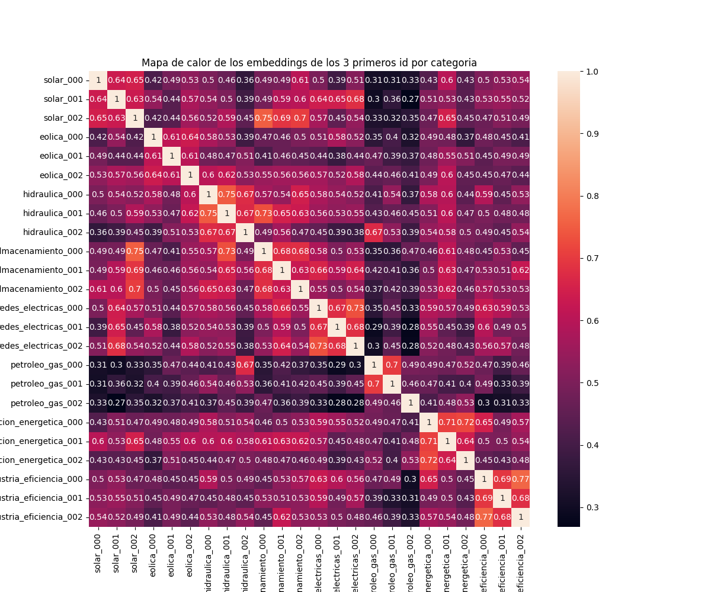

# Buscador semántico en español, con evaluación y RAG

Compara un buscador semántico (embeddings + ChromaDB) contra un baseline por palabras clave sobre un corpus propio de textos sobre energía en español, midiendo cuánto mejora realmente la búsqueda semántica con Recall@1, Recall@3 y MRR. Después, se implementa un sistema RAG

## Captura de ejemplo

```
$ python cli.py "¿cómo funcionan los paneles solares?" -k 3

=================================================================
RESULTADOS DE LA BÚSQUEDA SEMÁNTICA
=================================================================

Resultado 1
  ID:         solar_000
  Categoría:  solar
  Similitud:  0.5610
  Texto:      Las celdas de silicio monocristalino alcanzan eficiencias del 22-23%...
-----------------------------------------------------------------
Resultado 2
  ID:         solar_000
  Categoría:  solar
  Similitud:  0.5560
  ...
```

## Motivación

Los buscadores por palabras clave fallan cuando una pregunta no usa el mismo vocabulario que la respuesta que busca, algo muy habitual en lenguaje natural. Este proyecto construye un buscador semántico real sobre un corpus propio y lo compara, con métricas y preguntas de prueba diseñadas a propósito, contra un baseline simple por solapamiento de palabras — para responder con datos, no con intuición, cuánto mejora uno sobre el otro.

## Cómo funciona

```
documentos.json (corpus)
      │
      ▼
embeddings.py ──► Voyage AI (con caché local) ──► vectores (1024 dim)
      │
      ▼
almacen.py ──► ChromaDB (persistente, métrica coseno, metadatos)
      │
      ▼
buscador.py ──► buscar(pregunta, k, categoria) ──► resultados ordenados por similitud
      │
      ▼
cli.py ──► búsqueda interactiva por consola
      │
      ▼
rag.py ──► recuperación de respuestas + fuentes


```

En paralelo, `baseline.py` implementa un buscador por solapamiento de palabras clave con la misma firma y estructura de salida que `buscar()`, y `evaluar.py` calcula Recall@1, Recall@3 y MRR para ambos sobre un conjunto de 35 preguntas de prueba (`data/preguntas_prueba.json`).

## Instalación

```bash
git clone <url-de-este-repo>
cd buscador-semantico
python -m venv venv
source venv/bin/activate   # En Windows: venv\Scripts\activate
pip install -r requirements.txt
cp .env.example .env
# Edita .env y añade tu VOYAGE_API_KEY (gratis en https://dashboard.voyageai.com)
```

Para dejar el buscador listo desde cero:

```bash
python almacen.py       # genera embeddings (con caché) e ingesta el corpus en Chroma
python cli.py "¿cómo funciona la energía solar?" -k 3
```

> **Nota:** el corpus `data/documentos.json` ya está incluido en el repositorio para que puedas probar el proyecto sin generar tu propio corpus. La caché de embeddings y la base de datos de Chroma **no** se incluyen (se regeneran al ejecutar `almacen.py`, consumiendo parte de la cuota gratuita de Voyage).

## Ejemplos de uso

```bash
# Búsqueda simple
python cli.py "¿qué es el hidrógeno verde?"

# Pidiendo más resultados
python cli.py "¿cómo se almacena la energía solar?" -k 5

# Filtrando por categoría
python cli.py "¿cuánto cuesta una batería?" -k 3 --categoria almacenamiento
```

Categorías disponibles: `solar`, `eolica`, `hidraulica`, `almacenamiento`, `redes_electricas`, `petroleo_gas`, `transicion_energetica`, `industria_eficiencia`.

## Resultados

### Tabla comparativa (35 preguntas de prueba, k=3)

| Método | Recall@1 | Recall@3 | MRR |
|---|---|---|---|
| Palabras clave | 0.229 | 0.429 | 0.314 |
| Semántico (solo pregunta) | 0.629 | 0.886 | 0.752 |
| Semántico (pregunta + respuesta) | 0.886 | 1.000 | 0.938 |

**Desglose por dificultad de la pregunta** (9 preguntas "fáciles", comparten palabras con la respuesta; 26 "difíciles", reformuladas sin vocabulario literal compartido):

| Método | Recall@1 (fácil) | Recall@1 (difícil) | Recall@3 (fácil) | Recall@3 (díficil) | MRR (fácil) | MRR (difícil)
|---|---|---|---|---|---|---|---|
| Palabras clave | 0.667 | 0.077 | 0.778 | 0.308 | 0.704 |0.179 
| Semántico (solo pregunta) | 0.889 | 0.538 |  1  | 0.846 | 0.944 | 0.686
| Semántico (pregunta + respuesta) | 0.889 | 0.885 | 1 | 1 | 0.944 | 0.936

### Mapa de calor de similitudes



El mapa muestra la similitud coseno entre 24 documentos (3 por categoría). Los bloques de mayor similitud a lo largo de la diagonal corresponden a documentos de la misma categoría, confirmando que los embeddings agrupan correctamente por significado antes incluso de construir el pipeline de búsqueda completo.

### El experimento: pregunta vs pregunta+respuesta

Cambiando una sola variable (qué texto se embebe al ingestar el corpus: solo la `pregunta` de cada documento, frente a `pregunta + respuesta` concatenadas), el resultado es claro: **embeber pregunta+respuesta mejora sustancialmente las tres métricas**, y especialmente el rendimiento en preguntas difíciles (Recall@1 pasa de 0.538 a 0.885). La hipótesis es que la respuesta completa aporta mucho más vocabulario, contexto y matiz semántico que la pregunta corta del documento, dando al embedding más "superficie" con la que relacionar una consulta nueva, incluso cuando esa consulta no comparte palabras literales con el texto original.

### Análisis de errores

Cinco preguntas donde incluso el mejor modo semántico (pregunta+respuesta) falla en Recall@1:

1. **"¿Qué datos se usan para medir si una planta industrial está consumiendo energía de forma eficiente?"** (esperado: `industria_eficiencia_007`, obtenido: `industria_eficiencia_000`). *Hipótesis*: la categoría es correcta, pero varios documentos de "industria_eficiencia" tratan temas muy próximos entre sí (auditorías, KPIs, gestión energética), y el embedding no tiene suficiente resolución para distinguir el documento específico correcto dentro de un clúster temático denso.

2. **"¿Por qué es tan importante poder guardar electricidad para que las fuentes limpias sustituyan del todo a las sucias?"** (esperado: `transicion_energetica_003`, obtenido: `redes_electricas_000`). *Hipótesis*: el documento esperado está en la frontera temática entre "transición energética" y "almacenamiento" — el sistema trae contenido genuinamente relacionado de una categoría vecina, más que fallar en entender la pregunta.

3. **"¿Cómo detecta el sistema eléctrico cuándo hay un problema y corta la corriente automáticamente?"** (esperado: `redes_electricas_005`, obtenido en posición 2 — Recall@3 sí acierta). *Hipótesis*: el primer resultado (`redes_electricas_000`, sobre smart grids en general) es temáticamente muy amplio y tiende a aparecer arriba en consultas genéricas de esa categoría, actuando casi como un documento "comodín".

4. **"¿Qué son las instalaciones pequeñas que pueden generar y usar su propia luz sin depender de la red general?"** (esperado: `redes_electricas_004`, sobre microrredes). *Hipótesis*: la paráfrasis se aleja tanto del término técnico ("microrredes") que se superpone más con el concepto vecino de "autoconsumo solar" que con el concepto específico buscado — un caso límite de reformulación.

5. **"¿Cuánto cuesta hoy en día instalar baterías para guardar electricidad y bajará ese precio con el tiempo?"** (esperado: `almacenamiento_005`, sobre costes, obtenido: `almacenamiento_001`, sobre ventajas). *Hipótesis*: mismo patrón que el caso 1 — varios documentos de "almacenamiento" compiten semánticamente por la misma pregunta.

**Patrón general**: la mayoría de los fallos no son por "no entender" la pregunta, sino por **falta de granularidad entre documentos muy próximos temáticamente**, dentro de la misma categoría o en categorías vecinas con solapamiento real de contenido.


# Implementación RAG
Una vez implementado y evaluado el sistema de recuperación semántica, el siguiente paso consiste en utilizar los documentos recuperados para generar respuestas fundamentadas en sus contenidos mediante un modelo de lenguaje (LLM).

## Arquitectura e implementación
Se incorpora RAG.py, que integra el buscador semántico desarrollado previamente con la API de Anthropic.

El flujo de generación sigue estos pasos:

Recuperación: se obtiene el top-k de documentos más similares a la pregunta mediante el buscador semántico.

Filtrado por similitud: se comprueba si el mejor resultado supera un umbral configurable. Si no se recuperan documentos o la similitud máxima queda por debajo del umbral, el sistema se abstiene de generar una respuesta.

Construcción del contexto: se concatenan los textos recuperados junto con sus identificadores.

Generación: se envían la pregunta y el contexto a Claude Haiku, indicándole que responda exclusivamente a partir de la información proporcionada y que identifique las fuentes utilizadas.

Este diseño incorpora un mecanismo inicial de abstención para reducir el riesgo de responder cuando la recuperación no aporta suficiente evidencia. Sin embargo, superar el umbral de similitud no garantiza por sí solo que los documentos recuperados contengan información suficiente para responder correctamente.

## Evaluación de la fundamentación 
Para analizar la fiabilidad de las respuestas se desarrolla evaluar_rag.py, que incorpora un evaluador basado en un segundo modelo de lenguaje (LLM-as-a-judge).

La función juez recibe la pregunta original, la respuesta generada y los documentos recuperados, y clasifica la respuesta en tres categorías:

fundamentada: la respuesta está respaldada por los documentos fuente.

parcialmente_fundamentada: solo una parte de la respuesta está respaldada por las fuentes.

no_fundamentada: la respuesta no cuenta con respaldo suficiente o presenta información que no se puede justificar con los documentos.

La evaluación se realiza sobre dos conjuntos de preguntas:

35 preguntas del dominio: preguntas utilizadas previamente para evaluar la recuperación semántica.

8 preguntas fuera de dominio: consultas sobre temas distintos al corpus energético, diseñadas para comprobar si el sistema evita producir respuestas sin respaldo documental.

Los resultados se almacenan en data/resultados_evaluacion_rag.json, con el detalle de cada pregunta, la respuesta generada, el veredicto del evaluador y el origen de la consulta. Además, resumen_rag agrupa los veredictos por conjunto de preguntas para facilitar el análisis.
A continuación, se muestra una tabla con los resultados obtenidos en la última ejecución:

| Conjunto | Fundamentada | Parcialmente fundamentada| No fundamentada |
|---|---|---|---|
|35 preguntas dominio| 34 | 1 | 0 |
|8 preguntas fuera del dominio| 0 | 0 | 0 |

El evaluador constituye una aproximación automatizada a la fundamentación de las respuestas, no una garantía de ausencia de alucinaciones. Sus propios veredictos también pueden contener errores y deben interpretarse teniendo en cuenta esta limitación.


## Decisiones y límites buscador semántico.

- **Modelo de embeddings**: `voyage-4-lite`, con tier gratuito de 200M tokens — más que suficiente para este corpus.
- **Coste**: Se han pagado 5 dolares para generar el corupus utilizando la API de Anthropic.
- **Los textos del corpus y las preguntas de prueba salen hacia una API externa** (Voyage AI) para generar embeddings. No se envía ningún dato personal, solo el contenido del corpus generado.
- **El corpus es sintético**, generado con un LLM (ver atribución abajo) y revisado manualmente antes de su uso.
- **El baseline de palabras clave es intencionadamente simple** un baseline más sofisticado  probablemente reduciría algo la brecha frente al buscador semántico, pero no la eliminaría en los casos sin vocabulario compartido.

## Análisis de errores y decisiones de diseño RAG.

### Similitud semántica frente a relevancia real

Durante la evaluación con preguntas fuera de dominio se detectó un caso especialmente interesante:

Pregunta: «¿Es Rusia el país más grande del mundo?»

Aunque la pregunta no pertenece al dominio del corpus, la similitud máxima superó el umbral configurado de 0,3. Esto ocurrió porque uno de los documentos recuperados, petroleo_gas_002, compartía suficiente proximidad semántica superficial con la consulta para superar el filtro, pese a no contener información pertinente para responderla.

Este caso pone de manifiesto una limitación del sistema de recuperación: una puntuación de similitud elevada no implica necesariamente que el documento contenga evidencia útil para responder a la pregunta.

En la prueba observada, Claude se abstuvo de responder y explicó que los documentos disponibles no aportaban información suficiente. El evaluador clasificó el resultado como no_fundamentada, al no existir una respuesta factual respaldada por las fuentes.

Desde el punto de vista funcional, abstenerse fue un comportamiento deseable. Este caso evidencia la necesidad de distinguir entre la fundamentación de una respuesta y la decisión de responder o abstenerse.

### Variabilidad en la generación

Durante las pruebas se observó que la respuesta generada para la consulta sobre Rusia podía variar entre ejecuciones. Esto indica que el comportamiento del sistema no debe evaluarse a partir de un único ejemplo.

Para caracterizar su comportamiento sería conveniente repetir las pruebas con los mismos parámetros, registrar las respuestas obtenidas y medir la frecuencia con la que el sistema responde, se abstiene o produce información sin respaldo.

 ### Limitaciones del evaluador automático

La clasificación de respuestas mediante un segundo LLM permite automatizar parte del análisis, pero introduce una nueva fuente de incertidumbre: el propio evaluador puede interpretar incorrectamente la relación entre la respuesta y los documentos fuente.

Por ello, los resultados del juez deben entenderse como estimaciones de fundamentación, no como una verificación definitiva de la ausencia de alucinaciones.

## Licencia y atribución

- Código bajo licencia MIT (ver archivo LICENSE
- El corpus (`data/documentos.json`) fue generado con un modelo de lenguaje (Claude, vía API de Anthropic) a partir de prompts sobre el sector energético, y revisado manualmente antes de su uso en este proyecto. Fuente declarada en cada documento como `generado_LLM_revisado`.
- Las preguntas de prueba (`data/preguntas_prueba.json`) fueron generadas con asistencia de IA a partir del corpus, revisadas y ajustadas manualmente.

## Mejoras futuras

- Comparación con un modelo de embeddings open-source ejecutado localmente.

